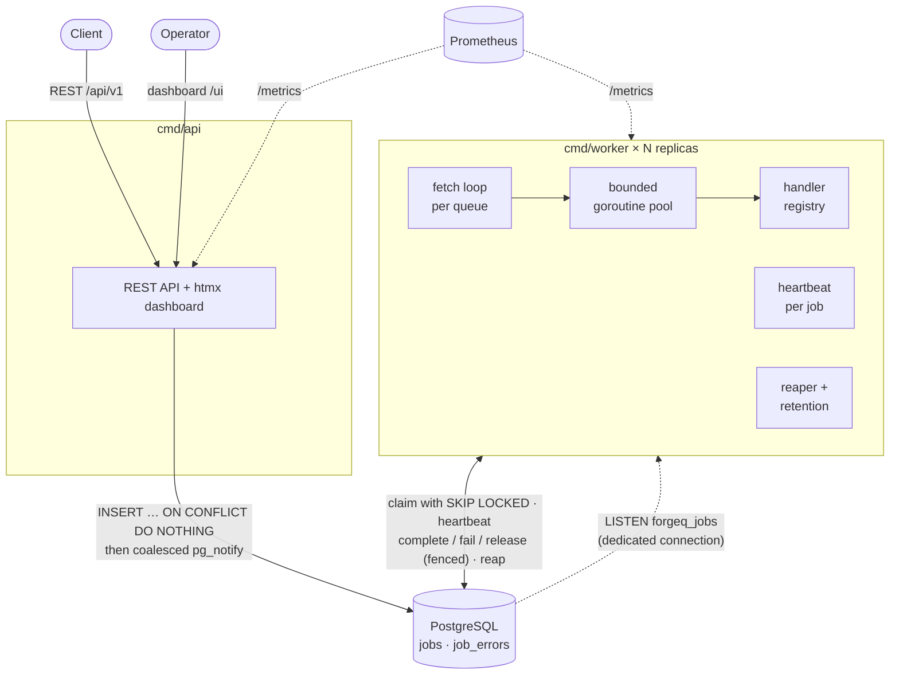
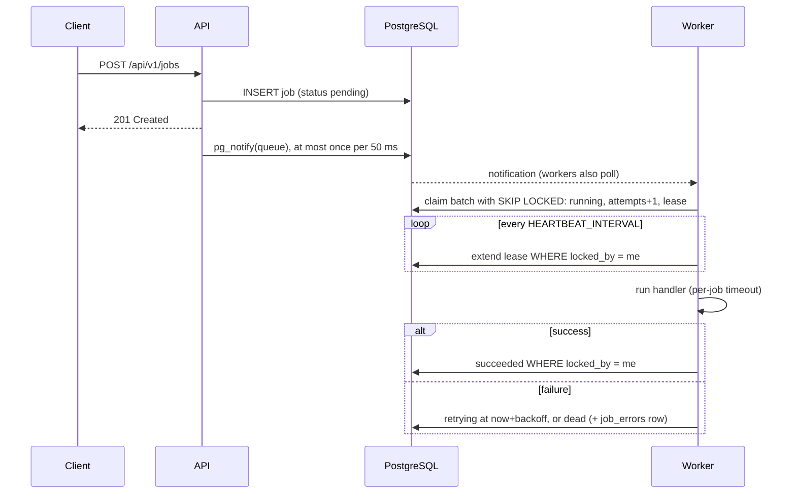
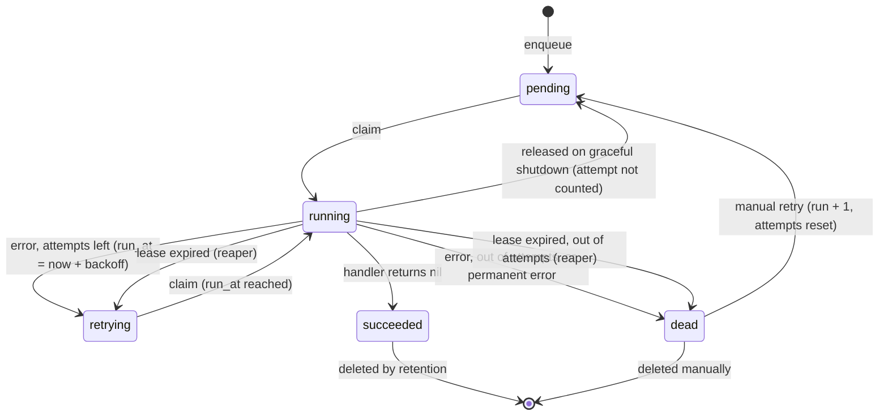

# ForgeQ

[](https://github.com/MFarrelAkbar1/ForgeQ-Backend/actions/workflows/ci.yml)

ForgeQ is a distributed background job queue written in Go, in the spirit of Sidekiq or Celery. PostgreSQL is its only source of truth. Clients enqueue jobs over HTTP (send an email, resize an image, build a report). Any number of worker processes then claim the jobs with `SELECT … FOR UPDATE SKIP LOCKED`, run them with a lease and a heartbeat, retry failures with exponential backoff, and move jobs that keep failing to a dead-letter queue. An htmx dashboard, Prometheus metrics and a load and chaos generator come with it.

**Highlights**

- **Atomic claiming.** Concurrent workers never receive the same job (`SKIP LOCKED`, covered by tests at 32-way contention).
- **Leases with a fenced heartbeat.** If a worker crashes or stalls, its job is recovered. A stale worker can never overwrite the job's state.
- **Retries and dead letters.** Exponential backoff with jitter, then a dead-letter queue with manual retry and full error history.
- **Graceful shutdown.** In-flight jobs get time to finish. Interrupted jobs go back to the queue without using up an attempt.
- **Idempotent enqueue.** Duplicate requests are deduplicated by an idempotency key, safely under concurrency.
- **Operations.** htmx dashboard, Prometheus metrics, liveness and readiness probes, an API key, and a Docker Compose stack.
- **Measured.** Benchmarks, chaos testing (random `SIGKILL`s under load) and CI with the race detector.

## Contents

- [Architecture](#architecture)
- [Job lifecycle](#job-lifecycle)
- [Design decisions](#design-decisions)
- [Delivery guarantee](#delivery-guarantee)
- [Quick start](#quick-start)
- [API](#api)
- [Writing a handler](#writing-a-handler)
- [Configuration](#configuration)
- [Benchmarks](#benchmarks)
- [Testing](#testing)
- [Project layout](#project-layout)
- [Limitations & next steps](#limitations--next-steps)

## Architecture



How a job moves through the system:



## Job lifecycle



| Status | Meaning |
|---|---|
| `pending` | Waiting to run. `run_at` can be in the future for delayed jobs. |
| `running` | Claimed by a worker that holds a lease (`locked_by`, `locked_until`). |
| `retrying` | Failed. Runs again at `run_at`. |
| `succeeded` | Finished. Deleted after `JOB_RETENTION`. |
| `dead` | Out of attempts or permanently failed. This is the dead-letter queue. |

The allowed transitions are defined in one place (`internal/job`) and tested exhaustively. Every transition in the database is a single statement guarded by the expected current status.

## Design decisions

Each decision lists the problem it solves and what it costs.

### PostgreSQL as the only source of truth (no Redis)
- **Problem:** a queue must not lose jobs, and job state has to agree with the rest of the application's data.
- **Decision:** jobs, leases, retries and history all live in Postgres. Every state change is one guarded `UPDATE`, or one transaction. Redis is not used at all.
- **Trade-off:** you get durability, transactions, ad-hoc SQL for debugging, and one less system to run and reason about when it fails. In exchange, throughput is bounded by a single Postgres primary and by its commit latency (see [Benchmarks](#benchmarks)), and a busy queue table needs vacuum attention.

### Claiming with `FOR UPDATE SKIP LOCKED`
- **Problem:** many workers poll the same queue, and no job may run twice at the same time.
- **Decision:** one CTE selects the next runnable rows in priority order, `FOR UPDATE SKIP LOCKED`, and marks them `running` in the same statement. Concurrent claimers skip rows another transaction is already claiming instead of blocking on them. A partial index covers only claimable rows, so it stays small. Each worker claims at most as many jobs as it has free slots, which leaves work for other replicas.
- **Trade-off:** strict FIFO is not guaranteed under concurrency. Ordering is "priority, then roughly oldest first".

### `attempts` counted at claim time
- **Problem:** if attempts were counted on failure, a job that crashes its worker would never record a failure and could loop forever.
- **Decision:** `attempts` is incremented when the job is claimed.
- **Trade-off:** a crash uses up an attempt even when the job itself was fine. Graceful shutdown compensates for this (see below).

### Lease, heartbeat and fencing
- **Problem:** a fixed lease forces a bad choice. A short lease makes long jobs look dead; a long lease means crashes are noticed late.
- **Decision:** the lease is short (`LEASE_DURATION`, 30 s) and a heartbeat extends it every `HEARTBEAT_INTERVAL` (10 s) while the job runs. Every write a worker makes (heartbeat, complete, fail, release) includes `WHERE status='running' AND locked_by=$me`. If that matches 0 rows, the worker has lost the job. The handler's context is then cancelled with cause `ErrLeaseLost`, and nothing more is written.
- **Trade-off:**
  - Fencing protects the database state, not the outside world. A side effect that already happened stays done, which is why delivery is at-least-once.
  - Heartbeats cost one query per running job per interval. Batching them per worker is a possible optimization.

### Reaper and retention
- **Problem:** a crashed worker leaves jobs stuck in `running`, and finished jobs make the table grow forever.
- **Decision:**
  - **Reaper.** Every worker runs a reaper. In one atomic statement it locks expired leases (`SKIP LOCKED`), moves them to `retrying` or `dead`, and writes a `job_errors` row that names the stale worker. Row locking re-checks `locked_until`, so a heartbeat that lands first wins.
  - **Retention.** Succeeded jobs older than `JOB_RETENTION` (7 days) are deleted in batches of 1000, backed by an index built `CONCURRENTLY`.
- **Trade-off:**
  - There is no leader election. Several reapers can run harmlessly, at the cost of a few redundant queries; an advisory lock would remove them.
  - Reaped jobs are retried immediately, without backoff.

### Exponential backoff with jitter
- **Problem:** retrying immediately hammers a dependency that is down. Retrying on fixed intervals makes every job that failed together retry together (thundering herd).
- **Decision:** the delay is `min(base · 2^(attempts−1) + rand[0, jitter), max)`. The exponent uses `attempts−1` because attempts was already incremented at claim. The function is pure, has an injectable random source, and doubles step by step so it cannot overflow.
- **Trade-off:** additive jitter is predictable but spreads retries less than AWS-style "full jitter".

### Dead-letter queue with run numbers
- **Problem:** operators need to fix a failure's cause and re-run the job, or discard it, without losing what happened before.
- **Decision:**
  - Dead jobs stay in the same table with `status='dead'`.
  - A manual retry resets `attempts` and increments `run`, and the history is kept. Each `job_errors` row records its `(run, attempt)`, so the history reads "run 2, attempt 1".
  - Delete only works on `dead` or `succeeded` jobs, so a job is never deleted out from under a worker.
- **Trade-off:** one table is simpler than a separate dead-letter table (retry is a single `UPDATE`), but dead jobs share the table and its indexes with live ones.

### Graceful shutdown
- **Problem:** deploys stop workers in the middle of jobs.
- **Decision:**
  1. `SIGTERM` stops claiming at once.
  2. Running jobs get `SHUTDOWN_TIMEOUT` (25 s) to finish and report normally.
  3. Jobs still running after that are cancelled and released back to `pending` with `attempts−1`, because the job did not fail; the worker stopped.
  4. Jobs run under their own context rather than the signal's, so the signal alone never interrupts them.
- **Trade-off:**
  - The timeout must fit within the orchestrator's grace period. The compose file sets `stop_grace_period: 35s`; Docker's default of 10 s would `SIGKILL` the worker in the middle of releasing jobs.
  - A job that is interrupted again and again never runs out of attempts. This is by design.

### Wake-ups: coalesced NOTIFY plus polling
- **Problem:** polling alone either adds latency (long interval) or wastes queries (short interval).
- **First design:** a row trigger called `pg_notify` on every insert. Load testing showed enqueue capped at about **150 requests/s**. A transaction that issues `NOTIFY` takes a global lock while it commits, so every enqueue committed one after another and Postgres could no longer group their WAL flushes.
- **Decision:** the trigger was removed. `store.Notifier` sends `pg_notify` from its own transaction, after the job-writing transaction has committed, and at most once per queue per 50 ms. Workers `LISTEN` on a dedicated connection that reconnects with backoff, and keep polling as a fallback. Enqueue went from about **150 to about 2,750 requests/s** in the same setup.
- **Trade-off:**
  - A wake-up can arrive up to 50 ms late.
  - Only writes that go through the store send wake-ups.
  - Delayed jobs are found by polling.

### Idempotent enqueue
- **Problem:** clients retry requests that time out, which can create duplicate jobs.
- **Decision:** `INSERT … ON CONFLICT (queue, idempotency_key) DO NOTHING`, then `SELECT` the existing row. The first request gets `201`; a replay gets `200` with the same job. Concurrent requests with the same key cannot both insert (tested with 20 at once).
- **Trade-off:** the key lives as long as the job row, so once retention deletes a succeeded job, its key can be used again.

### Observability
- **Liveness and readiness.** `/healthz` never checks dependencies, so a database blip does not restart every replica at once. `/readyz` pings Postgres and never echoes error details.
- **Queue depth.** `forgeq_jobs{queue,status}` is read from Postgres on each scrape, so it is exact and shared by all replicas.
- **Worker metrics.** Counters and histograms for outcomes, duration, in-flight jobs and reaped jobs. The worker depends only on a small `Observer` interface, not on Prometheus.
- **Label cardinality.** Client-chosen values never become metric labels. Unregistered job types are reported as `unknown`, and HTTP routes are labelled by pattern (`/api/v1/jobs/{id}`).

### Security
- **API key.** When `API_KEY` is set, it protects all of `/api/v1` (Bearer token) and the dashboard (basic-auth password). Keys are compared in constant time on their SHA-256 digests. Probes and `/metrics` stay open.
- **CSRF.** Browsers attach basic-auth credentials to cross-site requests, so the dashboard's state-changing requests go through Go's `http.CrossOriginProtection`, which checks `Sec-Fetch-Site` and `Origin`. No CSRF tokens are needed.
- **Escaping and errors.** Templates auto-escape job data, and internal errors are logged but never returned to clients.

### Connection budget
- **Problem:** a load test with 4 worker replicas hit `too many clients already`. pgx defaults to `max(4, NumCPU)` connections per pool, and each worker also holds a LISTEN connection.
- **Decision:** `DB_MAX_CONNS` caps each process (10 for workers, 25 for the api in compose). A job holds a connection only briefly, so 50 slots do not need 50 connections.

## Delivery guarantee

**ForgeQ delivers at-least-once.** A job that is not completed is never lost, but it can run more than once. Handlers must be idempotent.

This happens when a worker crashes (`SIGKILL`) or stalls past its lease while running a job. The reaper requeues the job and another worker runs it. Fencing keeps the job's *state* correct, because the stale worker's late `Complete` is rejected, but a side effect the stale worker already performed (an email sent, a card charged) has still happened. `TestStalledWorkerCausesDuplicateExecution` reproduces this deterministically: one job, two executions of its side effect, and one final `succeeded`.

**Chaos run** (`task chaos`):
- **Load:** 10,000 jobs of 50 ms each on 3 worker replicas, with a 5 s lease.
- **Disruption:** one worker was killed (`SIGKILL`) or stopped gracefully about every 1.5 s, then restarted.

| | |
|---|---|
| Disruptions | 7 (2 × `SIGKILL`, 5 × graceful stop) |
| Jobs succeeded | **10,000 / 10,000** |
| Jobs lost | **0** |
| Jobs that needed more than one attempt | 26 |
| Jobs whose handler *completed* more than once | 0 in this run |

The 26 re-delivered jobs were cut off mid-execution by a `SIGKILL` and re-run by another worker after their lease expired. Gracefully stopped workers finished or released their jobs, so those jobs never show up as extra attempts. A completed-twice execution needs the crash to land in the short window between the handler returning and the `Complete` commit, which this run did not hit. The deterministic test above covers that case.

## Quick start

Requires Docker. For development without Docker you also need Go 1.27+ and [Task](https://taskfile.dev).

```sh
cp .env.example .env    # adjust ports if 5432/8080 are taken; set API_KEY to enable auth
task up                 # Postgres, migrations, API + dashboard, 2 workers
# or: task up:monitoring  (adds Prometheus on :9091)
```

- Dashboard: <http://localhost:8080/ui/> (basic-auth password = `API_KEY` when set, any username)
- API: `http://localhost:8080/api/v1/jobs`
- Metrics: `http://localhost:8080/metrics` (api) and `:9090/metrics` inside each worker
- Probes: `/healthz` (liveness), `/readyz` (database reachable)

`task down` stops the stack, and `task logs` follows api and worker logs.

To run the binaries directly:

```sh
task db:up && task migrate
task run:api        # terminal 1
task run:worker     # terminal 2
```

## API

All `/api/v1` requests need `Authorization: Bearer $API_KEY` when `API_KEY` is set.

```sh
# Enqueue (201 Created; 200 OK with the original job if the idempotency key was used before)
curl -X POST localhost:8080/api/v1/jobs \
  -H "Authorization: Bearer $API_KEY" -H "Content-Type: application/json" \
  -d '{
        "type": "send_email",
        "queue": "emails",
        "payload": {"to": "a@example.com", "subject": "Welcome"},
        "priority": 5,
        "max_attempts": 3,
        "idempotency_key": "welcome-42"
      }'

# Delayed job
curl -X POST localhost:8080/api/v1/jobs -H "Authorization: Bearer $API_KEY" \
  -d '{"type": "generate_report", "queue": "reports", "payload": {"report_id": "q3"},
       "scheduled_at": "2030-01-01T09:00:00Z"}'

# Job with its error history
curl -H "Authorization: Bearer $API_KEY" localhost:8080/api/v1/jobs/1

# List, newest first, keyset pagination via next_cursor
curl -H "Authorization: Bearer $API_KEY" 'localhost:8080/api/v1/jobs?status=dead&queue=emails&limit=20'
curl -H "Authorization: Bearer $API_KEY" 'localhost:8080/api/v1/jobs?status=dead&limit=20&cursor=123'

# Dead-letter actions
curl -X POST   -H "Authorization: Bearer $API_KEY" localhost:8080/api/v1/jobs/1/retry   # dead -> pending, run+1
curl -X DELETE -H "Authorization: Bearer $API_KEY" localhost:8080/api/v1/jobs/1         # dead or succeeded only
```

| Field | Default | Rules |
|---|---|---|
| `type` | required | lowercase letters, digits, `_ . -`, up to 100 characters |
| `queue` | `default` | same as `type` |
| `payload` | `{}` | any JSON |
| `priority` | `0` | −100…100; higher runs first |
| `max_attempts` | `5` | 1…100 |
| `scheduled_at` | now | RFC 3339 |
| `idempotency_key` | none | up to 255 characters, unique per queue |

Errors share one format: `{"error": {"code": "validation_failed", "message": "…", "fields": {"priority": "must be between -100 and 100"}}}`. The codes and statuses are: `400` for malformed JSON, `401` for a missing key, `404` for an unknown job, `409` for a wrong state (for example, retrying a job that is not dead), and `422` for invalid fields.

## Writing a handler

```go
registry := worker.NewRegistry()

registry.RegisterHandler("send_email", func(ctx context.Context, j *job.Job) error {
    var p struct{ To string `json:"to"` }
    if err := json.Unmarshal(j.Payload, &p); err != nil {
        return worker.Permanent(err) // never retried: goes straight to dead
    }
    return mailer.Send(ctx, p.To) // other errors: retried with backoff
}, worker.WithTimeout(30*time.Second))
```

- Return `nil` for success and an error to retry. Wrap the error with `worker.Permanent` to skip the remaining attempts.
- Respect `ctx`. It is cancelled on timeout, on lease loss (`context.Cause(ctx)` is `store.ErrLeaseLost`) and when a graceful shutdown times out (`worker.ErrShutdown`).
- Make handlers idempotent (see [Delivery guarantee](#delivery-guarantee)).
- A panic in a handler is recovered and treated as a failed attempt.

The demo worker registers `send_email`, `image_resize` and `generate_report`, which simulate work and fail at random (`DEMO_FAIL_RATE`), plus `bench` for load tests.

## Configuration

Everything is configured with environment variables (see `.env.example`). Invalid values are reported together at startup.

| Variable | Default | Used by | Description |
|---|---|---|---|
| `DATABASE_URL` | required | all | PostgreSQL connection string |
| `DB_MAX_CONNS` | `10` | api, worker | pgx pool size per process |
| `LOG_LEVEL` / `LOG_FORMAT` | `info` / `json` | api, worker | slog level; `json` or `text` |
| `HTTP_ADDR` | `:8080` | api | listen address |
| `API_KEY` | empty (auth off) | api | protects `/api/v1` and the dashboard |
| `WORKER_QUEUES` | `default:10` | worker | `queue:concurrency` pairs, e.g. `emails:5,reports:2` |
| `WORKER_ID` | hostname + random | worker | lease owner identity |
| `OPS_ADDR` | `:9090` | worker | `/healthz`, `/readyz`, `/metrics` |
| `POLL_INTERVAL` | `1s` | worker | fallback poll when no notification arrives |
| `LEASE_DURATION` | `30s` | worker | claim validity without a heartbeat |
| `HEARTBEAT_INTERVAL` | `10s` | worker | must be shorter than `LEASE_DURATION` |
| `DEFAULT_JOB_TIMEOUT` | `30s` | worker | per-job timeout unless the handler sets one |
| `SHUTDOWN_TIMEOUT` | `25s` | worker | time running jobs get after `SIGTERM` |
| `BACKOFF_BASE` / `BACKOFF_MAX` / `BACKOFF_JITTER` | `2s` / `1h` / `1s` | worker | retry delay |
| `REAPER_INTERVAL` | `15s` | worker | how often expired leases are recovered |
| `JOB_RETENTION` | `7d` | worker | succeeded jobs older than this are deleted (`d` suffix allowed) |
| `DEMO_FAIL_RATE` | `0.2` | worker | failure probability of the demo handlers |

Compose-only knobs: `POSTGRES_PORT`, `API_PORT`, `PROMETHEUS_PORT`, `WORKER_REPLICAS`, `API_DB_MAX_CONNS`.

## Benchmarks

`task bench` resizes the compose workers and runs `cmd/loadgen` for each configuration. The load generator runs inside the compose network, so Docker Desktop's port forwarding is not part of the measurement.

**Method**
- **Load:** each job is a `bench` job with 10 ms of simulated work.
- **Enqueue:** jobs are sent through the HTTP API with 50 concurrent requests, while the workers are already consuming.
- **Measurement:** all timings come from database timestamps (`created_at`, `started_at`, `finished_at`), so there is no clock skew between machines.
- **Throughput** is the number of jobs divided by the time from the first enqueue to the last finish. **Latency** is measured from enqueue to the start of the successful attempt.

**Machine**
- **Laptop:** Intel Core i7-13700HX (16 cores / 24 threads), 16 GB RAM, Samsung NVMe SSD, Windows 11.
- **Docker:** Docker Desktop 27.3 on WSL2, with 24 CPUs and 7.6 GB for the VM.
- **Postgres:** 18 (alpine) with default settings. A single-row `INSERT` commit takes **3.8 ms** on this setup (`pgbench`, fsync on), against 0.08 ms with `synchronous_commit=off`.

| Workers × slots | Jobs | Throughput (jobs/s) | Enqueue→start p50 | p95 | p99 |
|---|---:|---:|---:|---:|---:|
| 1 × 10 | 5,000 | 356 | 6,262 ms | 11,795 ms | 12,296 ms |
| 2 × 10 | 5,000 | 647 | 2,836 ms | 5,869 ms | 6,129 ms |
| 2 × 50 | 5,000 | 1,669 | 782 ms | 1,292 ms | 1,336 ms |
| 4 × 50 | 10,000 | 3,108 | 23 ms | 48 ms | 62 ms |

Enqueue ran at about 3,000 requests/s in every configuration.

**Reading the numbers**
- **Smaller configurations are saturated.** In the first three rows the workers are slower than the enqueue rate, so a backlog builds up. The latency there mostly measures time spent waiting in the queue.
- **4 × 50 keeps up.** Throughput is close to the enqueue rate, so throughput is bounded by the producer, and jobs start 23 ms after being enqueued (p50).
- **Each worker has a ceiling for short jobs.** One worker with 10 slots tops out around 350 jobs/s, well below the 1,000/s that 10 slots × 10 ms would allow. The likely cause is that each queue has a single fetch loop that claims jobs serially, and every claim and every completion is its own commit (about 3.8 ms here). When slots free up one at a time, refills are serialized behind that commit latency. More replicas (or more slots, which allows larger claim batches) scale almost linearly, as the table shows. Batching claims and completions is listed under next steps.
- **These are laptop numbers.** Docker Desktop's virtual disk makes fsync relatively slow. On a dedicated server with fast fsync, per-commit costs, and with them the per-worker ceiling, would improve.

Reproduce with `task up && task bench`, or run `task loadgen -- -jobs 2000 -sleep 5ms` for a single run.

## Testing

```sh
task test               # unit tests
task test:integration   # integration tests against a real Postgres (testcontainers, needs Docker)
task test:race          # both with the race detector
task check              # build + vet + unit + integration
```

**Unit tests**
- **Pure logic:** backoff, the state-transition table, job validation and config parsing.
- **Worker, against a fake store:** outcomes, concurrency limits, panics, timeouts, lease loss and shutdown.
- **HTTP layer, against fakes:** the API, dashboard (escaping, basic auth, cross-site rejection), auth and metrics.

**Integration tests** run against real PostgreSQL. Among other things they prove:
- **No double claims:** 32 claimers race for 5,000 jobs across two queues and none is handed out twice or lost. Four full worker instances process 3,000 jobs and each handler runs exactly once.
- **Idempotency:** 20 parallel enqueues with the same key create exactly one row.
- **Fencing:** a stale worker's heartbeat, complete and fail are all rejected. After a reaper takeover the stale handler is cancelled, and only the new owner's result is kept.
- **Shutdown:** an interrupted job is released without using up an attempt. Running jobs finish, and nothing new is claimed.
- **Retention:** only old succeeded jobs are deleted.
- **Wake-ups:** notifications are coalesced, and a plain insert does not notify (a guard against reintroducing the trigger).
- **At-least-once:** the duplicate-execution case is reproduced.

**CI** runs on every push: gofmt, build, vet, unit and integration tests, plus a parallel job with `-race`.

## Project layout

```
cmd/
  api/        HTTP API + dashboard + /metrics
  worker/     worker process (pool, heartbeat, reaper, ops server)
  migrate/    applies embedded migrations (goose)
  loadgen/    load generator, benchmark and chaos modes
internal/
  job/        domain model and state machine (no I/O)
  store/      PostgreSQL access (pgx), notifier, listener
  worker/     registry, pool, heartbeat, graceful shutdown, reaper
  api/        REST handlers, auth middleware, instrumentation
  dashboard/  html/template + htmx, embedded assets
  backoff/    retry delay policy
  metrics/    Prometheus recorders
  ops/        health, readiness, metrics endpoints
  auth/       constant-time key checks
  config/     environment parsing
  handlers/   demo and bench handlers
migrations/   SQL migrations (embedded)
test/integration/  tests against real PostgreSQL
deploy/       Prometheus config
```

## Limitations & next steps

**Throughput and scale**
- **Per-worker ceiling for short jobs.** Claims run serially per queue and each completion is its own commit. Next: batch completions, refill several slots per claim, or prefetch a small buffer.
- **One Postgres primary is both the throughput ceiling and a single point of failure.** High churn creates dead tuples, so very high volumes would need partitioning by time (dropping old partitions instead of deleting rows) and autovacuum tuning.
- **The dashboard and queue-depth metrics run `GROUP BY` counts.** That is cheap at this scale thanks to retention, but large deployments would want estimates or cached counters.

**Semantics**
- **Delivery is at-least-once only.** Exactly-once side effects would need idempotency keys on the downstream calls or a transactional outbox.
- **Reaped jobs retry immediately**, without backoff.
- **Retry policy and timeouts are configured per worker process (timeouts per handler), not per job via the API.**
- **Priority is strict,** so a steady stream of high-priority jobs can starve low-priority ones. There is no aging and no fair scheduling across queues.
- **Idempotency keys only last as long as the job row.**
- **Not supported yet:** periodic (cron) jobs, job dependencies or workflows, per-queue rate limits, pausing a queue, or cancelling a running job.

**Operations and security**
- **Authentication is a single shared key** with no per-user identity or roles. `/metrics` is unauthenticated, as is common, but it reveals queue names.
- **Handlers are compiled into the worker binary.** There is no plugin or multi-language worker protocol.
- **The benchmarks come from one laptop** under Docker Desktop and are indicative only.
