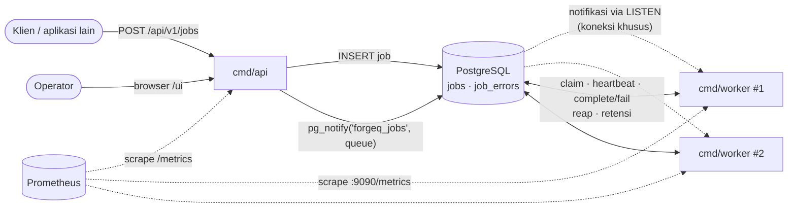
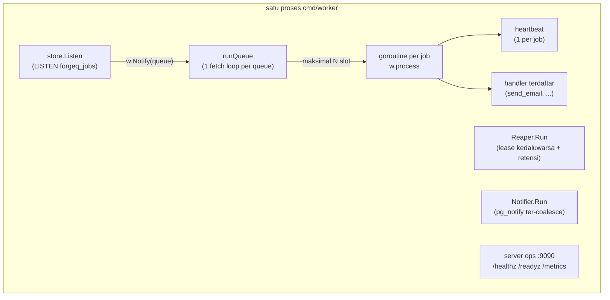
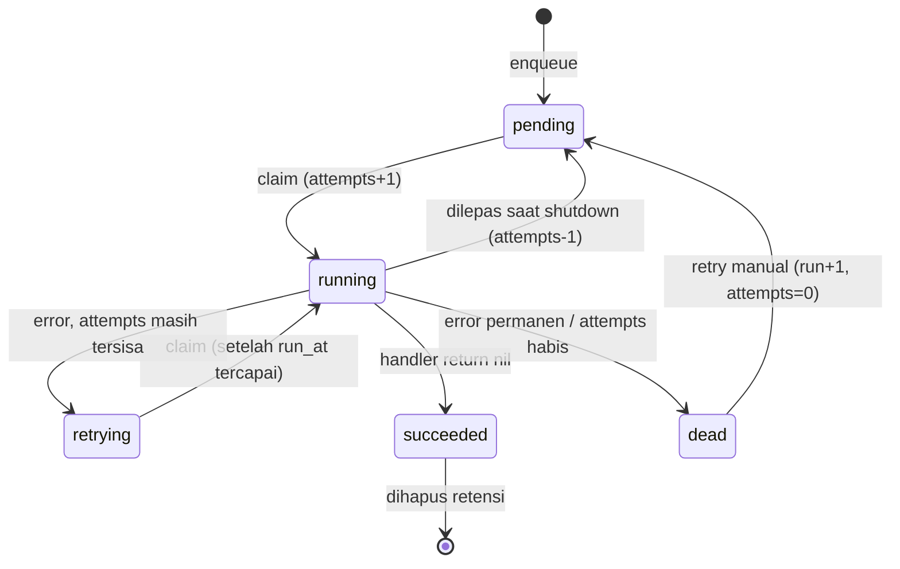
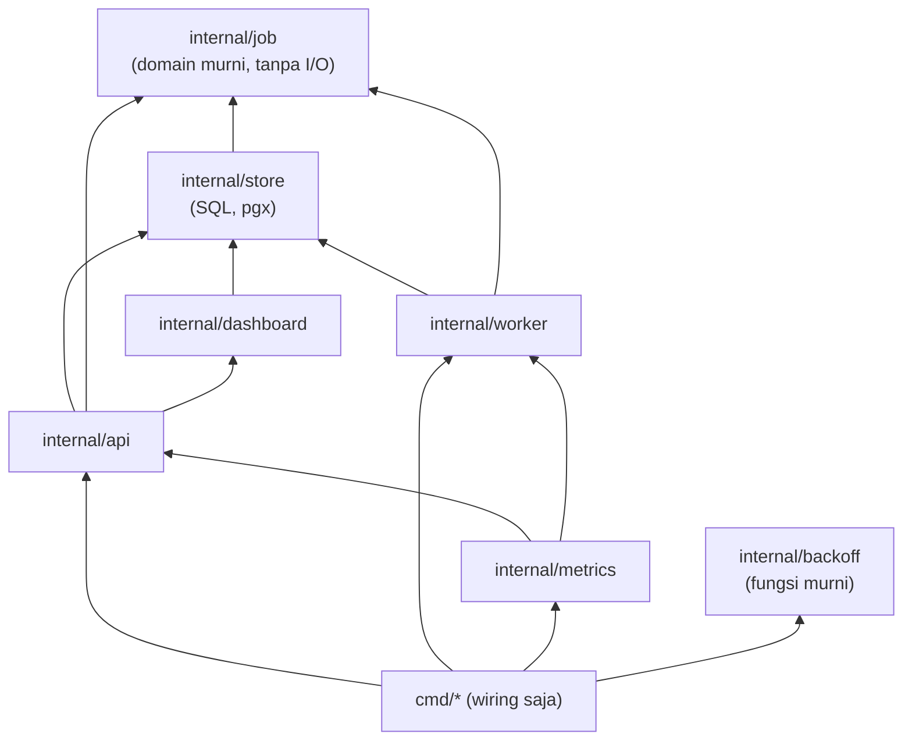

# 00 · Gambaran besar

> Tujuan file ini: sebelum membaca satu baris kode pun, kamu paham **masalah apa** yang diselesaikan ForgeQ, **siapa saja komponennya**, dan **bagaimana mereka saling bicara**.

## 1. Masalah yang diselesaikan job queue

Bayangkan sebuah aplikasi toko online. Saat pengguna mendaftar, server harus:

1. menyimpan akun ke database (cepat, ~5 ms),
2. mengirim email selamat datang lewat SMTP (lambat, 300 ms sampai beberapa detik, dan **kadang gagal**),
3. membuat thumbnail foto profil (lambat, CPU-heavy).

Kalau langkah 2 dan 3 dikerjakan **di dalam request HTTP**, ada tiga masalah:

| Masalah | Akibat |
|---|---|
| **Lambat** | Pengguna menunggu 3 detik hanya untuk melihat "Pendaftaran berhasil". |
| **Rapuh** | SMTP sedang down sehingga request gagal, padahal akunnya sudah tersimpan. Pengguna bingung dan mencoba lagi, lalu akunnya jadi dobel. |
| **Tidak bisa diatur** | 10.000 pendaftaran serentak berarti 10.000 koneksi SMTP serentak, dan server email ikut tumbang. |

**Job queue** memecah pekerjaan menjadi dua bagian:

- **Request HTTP** hanya *mencatat* "tolong kirim email ke X" sebagai sebuah **job**, lalu langsung menjawab `201 Created`.
- **Worker** (proses terpisah) mengambil job satu per satu, mengerjakannya, dan **mengulang (retry)** kalau gagal.

Hasilnya: request cepat, kegagalan sementara diulang otomatis, dan jumlah pekerjaan paralel bisa dibatasi.

## 2. Analogi: dapur restoran

| Restoran | ForgeQ |
|---|---|
| Pelayan menulis pesanan di kertas dan menempelkannya di rel pesanan | **API** menyimpan job ke tabel `jobs` |
| Rel pesanan | **PostgreSQL** (tabel `jobs`) |
| Koki mengambil kertas pesanan, lalu memasak | **Worker** meng-*claim* job, lalu menjalankan *handler* |
| Koki menulis nama di kertas: "sedang dimasak oleh Budi, sampai jam 12.05" | **Lease**: kolom `locked_by` dan `locked_until` |
| Setiap 10 menit Budi memperpanjang tulisan "sampai jam ..." | **Heartbeat** |
| Budi pingsan. Kepala dapur melihat kertas yang waktunya sudah lewat dan menaruhnya kembali di rel | **Reaper** |
| Kompor mati, jadi pesanan dicoba lagi 2 menit, lalu 4 menit kemudian | **Retry dengan backoff** |
| Pesanan yang gagal 5 kali ditaruh di nampan "bermasalah" untuk dicek manajer | **Dead-letter queue** (`status = 'dead'`) |
| Bel dapur berbunyi saat ada pesanan baru, jadi koki tidak perlu bolak-balik mengecek rel | **LISTEN/NOTIFY** |
| Saat restoran tutup, koki menyelesaikan masakan yang sedang dimasak, dan yang belum sempat dikembalikan ke rel | **Graceful shutdown** |

Satu hal penting dari analogi ini: **kertas pesanan adalah satu-satunya sumber kebenaran.** Tidak ada koki yang menyimpan catatan pribadi. Di ForgeQ, prinsip ini berarti **PostgreSQL adalah satu-satunya sumber kebenaran**. Tidak ada Redis, dan tidak ada state penting yang hanya ada di memori worker.

## 3. Komponen ForgeQ

ForgeQ terdiri dari **empat program** (`cmd/*`) dan **satu database**:

| Program | File | Tugas |
|---|---|---|
| `api` | [`cmd/api/main.go`](../../cmd/api/main.go) | HTTP API (`/api/v1/jobs`), dashboard htmx (`/ui`), `/healthz`, `/readyz`, `/metrics` |
| `worker` | [`cmd/worker/main.go`](../../cmd/worker/main.go) | Mengambil dan menjalankan job. Di dalamnya juga berjalan *reaper* dan server ops di `:9090` |
| `migrate` | [`cmd/migrate/main.go`](../../cmd/migrate/main.go) | Membuat dan memperbarui skema tabel (goose) |
| `loadgen` | [`cmd/loadgen/main.go`](../../cmd/loadgen/main.go) | Alat benchmark dan *chaos test* (bukan bagian dari sistem produksi) |
| PostgreSQL | [`migrations/`](../../migrations/) | Tabel `jobs` dan `job_errors` |

Program-program ini **tidak pernah berbicara langsung satu sama lain**. API tidak tahu ada berapa worker, dan worker tidak tahu ada API. Semuanya lewat PostgreSQL:



Garis putus-putus berarti "opsional atau hanya mempercepat". Kalau notifikasi hilang, worker tetap menemukan job lewat **polling** setiap `POLL_INTERVAL` (default 1 detik).

### Isi satu proses worker

Satu proses worker menjalankan beberapa goroutine sekaligus:



## 4. Siklus hidup sebuah job (state machine)

Setiap job selalu berada di **tepat satu** dari lima status. Aturan perpindahannya ada di satu tempat: variabel `transitions` di [`internal/job/job.go`](../../internal/job/job.go).



| Status | Artinya |
|---|---|
| `pending` | Menunggu dijalankan. `run_at` bisa di masa depan (job tertunda). |
| `running` | Sedang dipegang worker yang memiliki *lease* (`locked_by`, `locked_until`). |
| `retrying` | Gagal, dan akan dicoba lagi saat `run_at` tercapai. |
| `succeeded` | Selesai (terminal). Dihapus setelah `JOB_RETENTION`. |
| `dead` | Menyerah. Inilah *dead-letter queue*. Butuh tindakan manusia. |

## 5. Arah dependensi antar-package

Kode Go di `internal/` disusun supaya bagian yang paling "murni" tidak bergantung pada apa pun:



Prinsip kuncinya: **interface didefinisikan di sisi pemakai.** `worker.Store` adalah interface kecil di package `worker` yang berisi hanya `Claim`, `Heartbeat`, `Complete`, `Fail` dan `Release`. `*store.Store` kebetulan memenuhinya. Karena itu unit test worker bisa memakai `fakeStore` di memori tanpa database (lihat `internal/worker/worker_test.go`).

## 6. Peta panduan ini

| File | Konsep |
|---|---|
| [01-perjalanan-satu-job.md](01-perjalanan-satu-job.md) | Menelusuri satu job dari `curl` sampai `succeeded`, lalu jalur gagal |
| [02-skip-locked-dan-claim.md](02-skip-locked-dan-claim.md) | Bagaimana banyak worker berbagi job tanpa rebutan |
| [03-lease-heartbeat-fencing.md](03-lease-heartbeat-fencing.md) | Mendeteksi worker mati dan mencegah worker "zombie" menulis |
| [04-backoff-jitter.md](04-backoff-jitter.md) | Kapan mencoba lagi setelah gagal |
| [05-dead-letter-queue.md](05-dead-letter-queue.md) | Ke mana job yang terus gagal pergi |
| [06-at-least-once-idempotency.md](06-at-least-once-idempotency.md) | Kenapa job bisa jalan dua kali dan bagaimana menghadapinya |
| [07-listen-notify.md](07-listen-notify.md) | Membangunkan worker, dan bottleneck yang ditemukan lewat load test |
| [08-graceful-shutdown.md](08-graceful-shutdown.md) | Deploy tanpa merusak job yang sedang berjalan |
| [09-reaper-retensi.md](09-reaper-retensi.md) | Membereskan job yatim dan menghapus data lama |
| [10-observability.md](10-observability.md) | Health probe, metrics, kardinalitas label |
| [11-keamanan.md](11-keamanan.md) | API key, perbandingan constant-time, CSRF |
| [12-anggaran-koneksi.md](12-anggaran-koneksi.md) | Berapa koneksi database yang dipakai semua proses |
| [13-clock-skew.md](13-clock-skew.md) | Jam siapa yang dipercaya |
| [urutan-membaca-kode.md](urutan-membaca-kode.md) | Urutan membaca file, dari yang paling sederhana |
| [glosarium.md](glosarium.md) | Daftar istilah |

### Cara memakai bagian "Eksperimen"

Setiap file konsep punya bagian **Eksperimen**: langkah untuk *sengaja merusak* fitur di branch terpisah, lalu melihat test mana yang gagal. Semua eksperimen sudah dijalankan saat panduan ini ditulis, dan hasil yang tercantum adalah output asli. Pola umumnya:

```sh
git switch -c coba/nama-eksperimen    # branch sementara
# ... ubah kode sesuai instruksi ...
go test -tags integration -count=1 -v -run '^TestNama$' ./test/integration/
git restore .                          # buang perubahan
git switch main && git branch -D coba/nama-eksperimen
```

Test integrasi butuh Docker yang menyala, karena testcontainers menjalankan PostgreSQL sementara. Unit test (`go test ./internal/...`) tidak butuh Docker.
