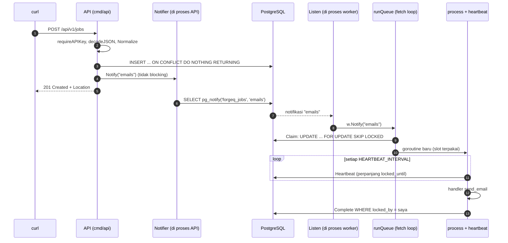

# 01 · Perjalanan satu job

> Kita ikuti **satu** job email dari `curl` sampai `succeeded`, langkah demi langkah. Di setiap langkah ada nama file dan fungsinya. Lalu kita ikuti jalur yang tidak mulus: **gagal → retry → dead → retry manual**.

Buka file-file ini di editor berdampingan selagi membaca:
[`internal/api/api.go`](../../internal/api/api.go), [`internal/store/store.go`](../../internal/store/store.go), [`internal/store/notifier.go`](../../internal/store/notifier.go), [`internal/store/listener.go`](../../internal/store/listener.go), [`internal/worker/worker.go`](../../internal/worker/worker.go).

---

## Bagian A: jalur bahagia (happy path)



### Langkah 1: klien mengirim request

```sh
curl -X POST localhost:8080/api/v1/jobs \
  -H "Authorization: Bearer $API_KEY" -H "Content-Type: application/json" \
  -d '{"type":"send_email","queue":"emails","payload":{"to":"a@example.com"}}'
```

### Langkah 2: router dan middleware (`internal/api/api.go`, `NewRouter`)

Request masuk ke router chi yang dibangun oleh `NewRouter`. Urutan middleware-nya:

1. `middleware.RequestID` memberi ID unik untuk setiap request, supaya log bisa dikorelasikan.
2. `instrument(...)` (di [`internal/api/respond.go`](../../internal/api/respond.go)) mencatat durasi dan status ke log dan metrics. Path probe (`/healthz`, `/readyz`, `/metrics`) dilewati.
3. `middleware.Recoverer` mengubah panic menjadi 500, jadi server tidak mati.
4. Khusus di bawah `/api/v1`: `requireAPIKey(o.APIKey)` memanggil `auth.ValidBearer` → `auth.Equal` (perbandingan constant-time, lihat [11-keamanan.md](11-keamanan.md)). Kalau gagal, responsnya **401**.

### Langkah 3: handler HTTP (`(*server).enqueue`)

```go
var req enqueueRequest
if err := decodeJSON(w, r, &req); err != nil {
    writeError(w, http.StatusBadRequest, "invalid_json", err.Error(), nil)
    return
}
```

`decodeJSON` (di `respond.go`) membatasi body maksimal 1 MiB (`http.MaxBytesReader`), menolak field yang tidak dikenal (`DisallowUnknownFields`), dan memastikan body hanya berisi **satu** objek JSON. JSON yang rusak menghasilkan **400**.

Request lalu diubah menjadi `job.NewJob` dan diteruskan ke `s.store.Enqueue`. Perhatikan bahwa `s.store` bertipe interface `api.Store`, bukan `*store.Store`. Di unit test, tempatnya diisi `fakeStore`.

### Langkah 4: validasi domain (`internal/job/new.go`, `(*NewJob).Normalize`)

`Store.Enqueue` pertama kali memanggil `n.Normalize()`, yang:

- mengisi default: `queue = "default"`, `max_attempts = 5`, `payload = {}`;
- memvalidasi `type`/`queue` (huruf kecil, angka, `_ . -`), `priority` (−100..100), `max_attempts` (1..100), dan panjang `idempotency_key`.

Kalau ada yang salah, hasilnya `*job.ValidationError`. Di handler, `errors.AsType[*job.ValidationError](err)` mengenalinya, dan responsnya **422** dengan `fields` per kolom.

### Langkah 5: INSERT (`internal/store/store.go`, `(*Store).Enqueue`)

```sql
INSERT INTO jobs (queue, type, payload, priority, max_attempts, run_at, idempotency_key)
VALUES ($1, $2, $3, $4, $5, COALESCE($6, now()), $7)
ON CONFLICT (queue, idempotency_key) WHERE idempotency_key IS NOT NULL DO NOTHING
RETURNING ...
```

- `COALESCE($6, now())`: tanpa `scheduled_at`, job langsung bisa dijalankan, dan jam yang dipakai adalah **jam database** (lihat [13-clock-skew.md](13-clock-skew.md)).
- Nilai default kolom di [`migrations/00001_create_jobs.sql`](../../migrations/00001_create_jobs.sql) mengisi `status = 'pending'`, `attempts = 0`, `run = 1` (dari migrasi 00003).
- `ON CONFLICT ... DO NOTHING` adalah mekanisme idempotency (lihat [06](06-at-least-once-idempotency.md)). Tanpa idempotency key, klausa ini tidak berpengaruh.

### Langkah 6: menjadwalkan wake-up (`Notifier.Notify`)

Setelah INSERT **sudah commit**, `Enqueue` memanggil `s.notify(j.Queue)`. Di proses API, fungsi ini adalah `(*Notifier).Notify` di [`internal/store/notifier.go`](../../internal/store/notifier.go):

```go
n.mu.Lock()
n.pending[queue] = struct{}{}   // tandai queue ini perlu dibangunkan
n.mu.Unlock()
select {
case n.kick <- struct{}{}:      // colek goroutine Run
default:                        // sudah dicolek, tidak perlu lagi
}
```

`Notify` **tidak pernah blocking** dan **tidak menyentuh database**, sehingga request HTTP tidak melambat.

### Langkah 7: respons ke klien

`s.obs.JobEnqueued(created)` menaikkan metrik `forgeq_jobs_enqueued_total{result="created"}`. Handler lalu menulis header `Location: /api/v1/jobs/{id}` (misalnya `/api/v1/jobs/96517`) dan body JSON job dengan status **201**. Kalau idempotency key sudah pernah dipakai, statusnya **200** dan isinya job yang lama.

### Langkah 8: NOTIFY dikirim (`(*Notifier).Run` → `flush`)

Goroutine `Notifier.Run` (dijalankan oleh `cmd/api/main.go`) bangun karena `kick`, lalu `flush` mengirim semua queue yang tertunda dalam **satu** statement di transaksinya sendiri:

```sql
SELECT pg_notify($1, q) FROM unnest($2::text[]) AS q
```

Setelah itu ia menunggu satu *window* (50 ms). Semua `Notify` selama 50 ms itu digabung menjadi satu notifikasi per queue. Kenapa tidak NOTIFY langsung di dalam INSERT? Jawabannya ada di [07-listen-notify.md](07-listen-notify.md).

### Langkah 9: worker menerima notifikasi (`store.Listen` → `(*Worker).Notify`)

Di proses worker, `cmd/worker/main.go` menjalankan `go store.Listen(ctx, cfg.DatabaseURL, logger, w.Notify)`. `listenOnce` membuka **koneksi khusus** (bukan dari pool), menjalankan `LISTEN forgeq_jobs`, lalu menunggu di `conn.WaitForNotification`. Saat notifikasi `"emails"` datang, ia memanggil `w.Notify("emails")`:

```go
select {
case ch <- struct{}{}:   // ch = w.wake["emails"], buffered(1)
default:                 // sudah ada wake-up yang menunggu
}
```

### Langkah 10: claim (`(*Worker).runQueue` → `(*Store).Claim`)

Setiap queue punya satu fetch loop `runQueue`. Loop ini sedang menunggu di `select` (timer poll, `w.wake[queue]`, atau `freed`). Wake-up membuatnya lanjut:

```go
free := concurrency - len(slots)          // slot kosong
jobs, err := w.store.Claim(ctx, queue, w.cfg.ID, free, w.cfg.LeaseDuration)
```

`Claim` menjalankan `claimQuery`. Dalam **satu statement** query ini:

1. memilih job `pending`/`retrying` dengan `run_at <= now()`, diurutkan menurut prioritas, dengan `FOR UPDATE SKIP LOCKED`;
2. mengubahnya menjadi `running`, `attempts + 1`, `locked_by = workerID`, `locked_until = now() + lease`, `started_at = now()`.

Detail lengkapnya ada di [02-skip-locked-dan-claim.md](02-skip-locked-dan-claim.md).

### Langkah 11: menjalankan di pool (`runQueue` → `inflight.Go`)

```go
for _, j := range jobs {
    slots <- struct{}{}                 // ambil token semaphore
    inflight.Go(func() {
        defer func() { <-slots; ... }() // kembalikan token saat selesai
        w.process(jobsCtx, j)
    })
}
```

`slots` adalah channel ber-buffer sebesar `concurrency` yang berfungsi sebagai **semaphore**. Perhatikan bahwa job berjalan di `jobsCtx`, **bukan** `ctx` dari sinyal OS (lihat [08-graceful-shutdown.md](08-graceful-shutdown.md)).

### Langkah 12: heartbeat dimulai (`(*Worker).process`)

```go
leaseCtx, loseLease := context.WithCancelCause(base)
hbCtx, stopHeartbeat := context.WithCancel(leaseCtx)
hbDone := make(chan struct{})
go func() {
    defer close(hbDone)
    w.heartbeat(hbCtx, j, loseLease, log)
}()
err := w.execute(leaseCtx, j)
```

`heartbeat` memanggil `store.Heartbeat` setiap `HEARTBEAT_INTERVAL` (10 s) untuk memperpanjang `locked_until`. Kalau database menjawab "0 baris" (job ini sudah bukan milik kita), heartbeat memanggil `loseLease(store.ErrLeaseLost)` dan ctx handler dibatalkan. Lihat [03-lease-heartbeat-fencing.md](03-lease-heartbeat-fencing.md).

### Langkah 13: handler dijalankan (`(*Worker).execute`)

```go
h, ok := w.registry.lookup(j.Type)               // tipe tidak terdaftar → Permanent
timeout := cmp.Or(h.timeout, w.cfg.JobTimeout)  // timeout per handler, atau default
ctx, cancel := context.WithTimeout(ctx, timeout)
defer func() { if r := recover(); r != nil { err = fmt.Errorf("handler panicked: %v", r) } }()
err = h.fn(ctx, j)
```

Untuk `send_email`, `h.fn` adalah `demo.sendEmail` di [`internal/handlers/handlers.go`](../../internal/handlers/handlers.go): decode payload, lalu `simulate` tidur 50–300 ms dan gagal dengan peluang `DEMO_FAIL_RATE`.

### Langkah 14: melaporkan sukses (`(*Worker).finish` → `(*Store).Complete`)

```go
stopHeartbeat()
<-hbDone          // heartbeat benar-benar berhenti SEBELUM menulis hasil
...
outcome = w.finish(j, err, took, log)
```

`finish` memakai **context baru** (`context.Background()` + 10 s), bukan context job, supaya hasil tetap tersimpan meski worker sedang shutdown. `Complete`:

```sql
UPDATE jobs SET status = 'succeeded', locked_by = NULL, locked_until = NULL,
               finished_at = now(), updated_at = now()
WHERE id = $1 AND status = 'running' AND locked_by = $2
```

Klausa `AND locked_by = $2` adalah **fencing**: hanya pemilik lease yang boleh menyelesaikan job ini.

### Langkah 15: bersih-bersih

- `Observer.JobFinished` menaikkan `forgeq_jobs_processed_total{outcome="succeeded"}` dan mencatat histogram durasi.
- Log `job succeeded` dengan `job_id`, `queue`, `type`, `attempt`, `took`.
- Token slot dikembalikan (`<-slots`). Kalau pool tadinya penuh, `freed` membangunkan fetch loop untuk claim lagi.

### Langkah 16: klien mengecek hasil

`GET /api/v1/jobs/{id}` → `(*server).get` → `store.Get` + `store.Errors` → JSON job beserta `errors` (riwayat kegagalan; di sini kosong).

### Langkah 17: tujuh hari kemudian

`Reaper.RunOnce` → `deleteOldSucceeded` → `store.DeleteSucceededBefore` menghapus job ini (lihat [09-reaper-retensi.md](09-reaper-retensi.md)).

---

## Bagian B: jalur gagal → retry → dead → retry manual

Misalkan SMTP sedang down, sehingga setiap percobaan mengembalikan `errors.New("smtp server unavailable")`, dan job dibuat dengan `max_attempts: 3`.

```mermaid
stateDiagram-v2
    direction LR
    state "running (attempts=1)" as r1
    state "retrying (run_at = now + ~2s)" as t1
    state "running (attempts=2)" as r2
    state "retrying (run_at = now + ~4s)" as t2
    state "running (attempts=3)" as r3
    state "pending (run=2, attempts=0)" as p2
    pending --> r1: claim
    r1 --> t1: Fail
    t1 --> r2: claim (poll)
    r2 --> t2: Fail
    t2 --> r3: claim (poll)
    r3 --> dead: Fail, attempts >= max_attempts
    dead --> p2: POST /retry
```



### Langkah B1: handler gagal → `finish` dengan `jobErr != nil`

```go
retryAt := time.Now().Add(w.cfg.RetryDelay(j.Attempts))
status, err := w.store.Fail(ctx, store.Failure{
    JobID: j.ID, WorkerID: w.cfg.ID,
    Error:     truncate(jobErr.Error(), maxErrorLength), // dipotong di batas rune UTF-8
    RetryAt:   retryAt,
    Permanent: IsPermanent(jobErr),
})
```

`RetryDelay` adalah `backoff.Policy{...}.Delay` yang dirakit di `cmd/worker/main.go`. Dengan default (`BACKOFF_BASE=2s`, `BACKOFF_JITTER=1s`), percobaan pertama menunggu 2–3 s, yang kedua 4–5 s, dan seterusnya (lihat [04-backoff-jitter.md](04-backoff-jitter.md)).

### Langkah B2: `(*Store).Fail` dalam satu transaksi

```sql
UPDATE jobs
SET status      = CASE WHEN $4 OR attempts >= max_attempts THEN 'dead' ELSE 'retrying' END,
    run_at      = CASE WHEN $4 OR attempts >= max_attempts THEN run_at ELSE $5 END,
    finished_at = CASE WHEN $4 OR attempts >= max_attempts THEN now() END,
    last_error = $3, locked_by = NULL, locked_until = NULL, updated_at = now()
WHERE id = $1 AND status = 'running' AND locked_by = $2   -- fencing
RETURNING status, run, attempts
```

lalu `INSERT INTO job_errors (job_id, run, attempt, error, worker_id)`. Keduanya ada di dalam `pgx.BeginFunc`, sehingga **status dan riwayat selalu konsisten**. `$4` adalah `Permanent`: error yang dibungkus `worker.Permanent(...)` langsung menjadi `dead` tanpa retry.

Keputusan "retry atau dead" diambil **di database** (`attempts >= max_attempts`), bukan di Go. Dengan begitu tidak ada celah antara membaca dan menulis.

### Langkah B3: menunggu `run_at`

Retry yang tertunda **tidak** mengirim NOTIFY, karena job-nya memang belum boleh jalan. Fetch loop menemukannya lewat **polling** (`POLL_INTERVAL`, 1 s) begitu `run_at <= now()` terpenuhi di `claimQuery`. Saat di-claim lagi, `attempts` menjadi 2.

Contoh log asli dari worker lokal (lihat "Coba sendiri" di bawah):

```
10:26:42.078 WARN job failed, will retry  job_id=96520 attempt=1 retry_at=10:26:43.146
10:26:44.060 WARN job failed, will retry  job_id=96520 attempt=2 retry_at=10:26:46.229
10:26:47.246 ERROR job dead               job_id=96520 attempt=3
```

`retry_at` attempt 1 adalah 43,146, tetapi attempt 2 baru gagal di 44,060. Selisih ini adalah waktu menunggu poll berikutnya (maksimal `POLL_INTERVAL`) ditambah durasi handler.

### Langkah B4: percobaan terakhir → `dead`

Pada percobaan ke-3, `attempts (3) >= max_attempts (3)`, jadi `Fail` menulis `status = 'dead'` dan `finished_at = now()`. Worker mencatat log `job dead` dengan outcome `dead`. Job kini muncul di tab **dead** dashboard (`/ui`, tab default-nya memang `dead`).

### Langkah B5: retry manual (`POST /api/v1/jobs/{id}/retry`)

`(*server).retry` → `(*Store).RetryDead`:

```sql
UPDATE jobs
SET status = 'pending', run = run + 1, attempts = 0, run_at = now(), last_error = NULL,
    started_at = NULL, finished_at = NULL, updated_at = now()
WHERE id = $1 AND status = 'dead'
RETURNING ...
```

- `run = run + 1`: ini "putaran" ke-2. Riwayat di `job_errors` **tidak dihapus**, jadi operator bisa membaca "run 1: attempt 1, 2, 3 gagal; run 2: attempt 1 ...".
- `attempts = 0`: jatah percobaan baru.
- `WHERE ... status = 'dead'`: hanya job dead yang bisa di-retry. Kalau 0 baris yang cocok, `notFoundOrInvalid` membedakan **404** (job tidak ada) dari **409** (job ada tapi statusnya bukan dead).
- Setelah commit, `s.notify(j.Queue)` dipanggil, jadi worker bangun dan job berjalan lagi dari Langkah 10.

Dari dashboard, alurnya sama: tombol Retry → `(*dashboard).retry` → `RetryDead` yang sama.

### Variasi: error permanen

Kirim `send_email` **tanpa** `payload.to`. `sendEmail` mengembalikan `worker.Permanent(errors.New("payload.to is required"))`, `IsPermanent` bernilai true, dan job langsung `dead` pada attempt 1. Payload yang salah tidak akan sembuh dengan menunggu.

---

## Coba sendiri

Langkah ini memakai Git Bash. Port `8081`/`5433` mengikuti `.env` di laptop ini (default di `.env.example` adalah 8080/5432). Jalankan dari root repo.

**Jalur bahagia** (stack compose: Postgres, api, 2 worker):

```sh
task up
API=http://localhost:8081
curl -s -X POST $API/api/v1/jobs -H "Content-Type: application/json" \
  -d '{"type":"send_email","queue":"emails","payload":{"to":"a@example.com"}}'
# → {"id":96517,"queue":"emails",...,"status":"pending","run":1,"attempts":0,...}
#   (id-nya tergantung isi database; pakai id dari respons kamu)
sleep 2
curl -s $API/api/v1/jobs/96517
# → "status":"succeeded","attempts":1,...,"errors":[]
#   (attempts bisa 2+ kalau kena DEMO_FAIL_RATE 20%)
task logs    # cari "job succeeded" dengan "job_id":96517
```

Perhatikan `created_at` dan `started_at` di respons. Saat diverifikasi, selisihnya hanya **19 ms**, jauh di bawah `POLL_INTERVAL` 1 s. Itu bukti wake-up NOTIFY bekerja.

Kirim request yang sama dua kali dengan `"idempotency_key":"belajar-1"`. Yang pertama menjawab `201`, yang kedua `200` dengan header `Location` yang sama (`/api/v1/jobs/96518`).

Kalau `API_KEY` di `.env` diisi, tambahkan `-H "Authorization: Bearer <key>"` ke setiap `curl`.

**Jalur gagal yang deterministik**: hentikan worker compose, lalu jalankan worker lokal yang **selalu** gagal dengan backoff pendek. Env var yang di-set di shell mengalahkan nilai di `.env`. `OPS_ADDR` diganti supaya tidak bentrok dengan port lain.

```sh
docker compose stop worker
DEMO_FAIL_RATE=1 BACKOFF_BASE=1s OPS_ADDR=:9095 task run:worker   # di terminal kedua
curl -s -X POST $API/api/v1/jobs -H "Content-Type: application/json" \
  -d '{"type":"send_email","queue":"emails","max_attempts":3,"payload":{"to":"a@example.com"}}'
# → {"id":96520,...,"status":"pending",...}
sleep 10
curl -s $API/api/v1/jobs/96520
# → "status":"dead","run":1,"attempts":3,"last_error":"smtp server unavailable",
#   "errors":[{"run":1,"attempt":1,...},{"run":1,"attempt":2,...},{"run":1,"attempt":3,...}]
curl -s -X POST $API/api/v1/jobs/96520/retry
# → "status":"pending","run":2,"attempts":0
curl -s -w ' %{http_code}\n' -X POST $API/api/v1/jobs/96520/retry
# → {"error":{"code":"invalid_state","message":"operation not allowed in the job's current status"}} 409
```

Setelah selesai, hentikan worker lokal (Ctrl+C) lalu jalankan `docker compose start worker`, atau `task down`.

---

## Latihan interview

1. Kenapa API menjawab `201` **sebelum** job dijalankan? Apa yang dijanjikan kode 201 itu kepada klien?
2. Di langkah mana `attempts` bertambah, dan kenapa bukan saat job gagal?
3. Kenapa `finish` memakai `context.Background()` dan bukan context job?
4. Keputusan "retry atau dead" dibuat di SQL (`CASE WHEN attempts >= max_attempts`). Apa risikonya jika keputusan itu dibuat di Go dengan membaca `j.Attempts` lalu menulis status?
5. Retry manual menaikkan `run` dan me-reset `attempts`. Kenapa tidak cukup me-reset `attempts` saja?

### Jawaban

1. `201` hanya menjanjikan bahwa job **sudah tersimpan secara durable** di PostgreSQL (INSERT sudah commit). Job itu tidak akan hilang meski API langsung mati. Eksekusinya asinkron, dan klien bisa memantau lewat `GET /api/v1/jobs/{id}`.
2. Di `claimQuery` (Langkah 10). Kalau dihitung saat gagal, worker yang crash di tengah job tidak pernah sempat memanggil `Fail`, sehingga `attempts` tidak bertambah. Job "racun" yang selalu membuat worker crash akan berputar selamanya. Dengan menghitung saat claim, crash pun tetap memakan satu jatah.
3. Context job bisa sudah dibatalkan (timeout, shutdown, atau lease hilang). Kalau `Complete`/`Fail` memakai context itu, query-nya langsung gagal dengan `context canceled` dan hasil kerja yang sudah selesai hilang. Context terpisah dengan timeout 10 s memastikan hasil tetap tercatat.
4. Ada jeda antara *membaca* dan *menulis* (race read-modify-write), dan nilai `j.Attempts` di memori bisa basi. Contohnya, reaper sudah mengambil alih job lalu worker lain meng-claim-nya sehingga attempts di DB sudah naik. Dengan `CASE` di satu statement yang di-fence, keputusan memakai nilai terkini dan atomik.
5. Tanpa `run`, riwayat `job_errors` akan berisi "attempt 1, 2, 3, 1, 2, ..." yang membingungkan, karena attempt 1 muncul dua kali. `run` memberi pasangan `(run, attempt)` yang unik, sehingga operator bisa membedakan kegagalan sebelum dan sesudah retry manual. Ini juga yang ditest oleh `TestRetryDeadKeepsHistory`.
