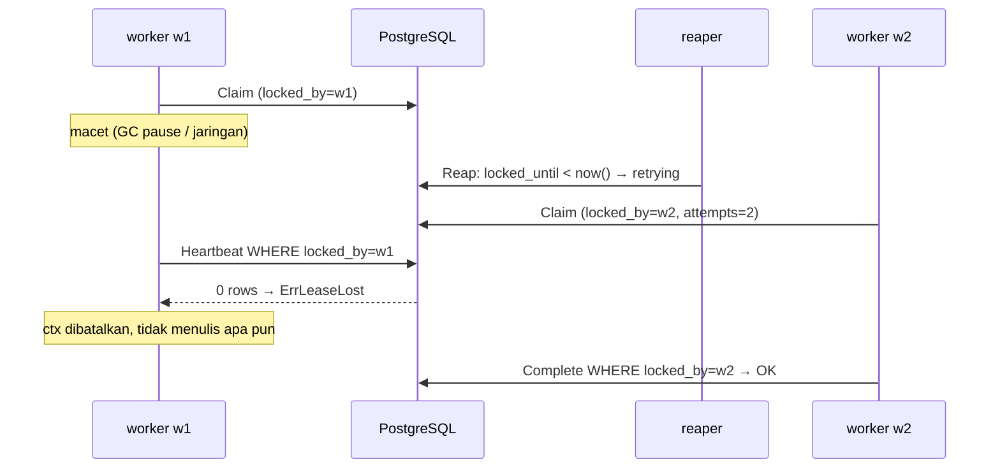

# 03 · Lease, heartbeat dan fencing

## Masalahnya apa?

Setelah job di-claim (file [02](02-skip-locked-dan-claim.md)), statusnya `running`. Lalu tiga skenario ini terjadi:

1. **Worker mati mendadak.** Container di-`SIGKILL` oleh OOM killer saat menjalankan job `generate_report`. Tidak ada yang menulis `succeeded` atau `failed`, sehingga job `running` **selamanya**. Laporan pelanggan tidak pernah dibuat.
2. **Job memang lama.** `generate_report` butuh 2 menit. Bagaimana sistem membedakan "worker mati" dari "worker masih bekerja keras"?
3. **Worker "zombie".** Worker A terkena *GC pause* atau jaringannya putus selama 45 detik. Sistem mengira A mati dan memberikan job ke worker B. Lalu A bangun dan menulis `UPDATE jobs SET status='failed' ...`, sehingga **menimpa** hasil B yang sudah sukses.

Kebutuhan: (1) mendeteksi worker mati dalam waktu wajar, (2) tidak salah menuduh job lama sebagai mati, (3) memastikan pemilik lama **tidak bisa menulis** setelah haknya dicabut.

## Konsep umumnya

- **Lease (sewa)**: claim tidak berlaku selamanya, hanya "milik worker X **sampai jam T**". Kalau T lewat tanpa diperpanjang, job dianggap yatim.
- **Heartbeat**: selama job berjalan, worker memperpanjang T secara berkala ("saya masih hidup"). Lease bisa pendek (deteksi crash cepat), dan job lama tetap aman selama heartbeat berjalan.
- **Fencing**: setiap tulisan menyertakan identitas pemilik lease, dan database menolaknya kalau pemiliknya sudah berganti. Istilah ini dipopulerkan Martin Kleppmann (*fencing token*). ForgeQ memakai `locked_by` (ID worker) sebagai token, dan pengecekannya terjadi **di database, di dalam statement yang sama**.

Lease menjawab masalah 1 dan 2. Fencing menjawab masalah 3. Tanpa fencing, lease justru **berbahaya**: lease memungkinkan dua pemilik (A yang lama dan B yang baru), dan hanya fencing yang memastikan hanya satu yang boleh menulis.

## Implementasi di ForgeQ

### Kolom lease

Di [`migrations/00001_create_jobs.sql`](../../migrations/00001_create_jobs.sql): `locked_by TEXT` dan `locked_until TIMESTAMPTZ`. Keduanya diisi oleh `claimQuery` (`locked_until = now() + LEASE_DURATION`, default 30 s).

### Heartbeat: `(*Worker).heartbeat` di [`internal/worker/worker.go`](../../internal/worker/worker.go)

```go
t := time.NewTicker(w.cfg.HeartbeatInterval)          // default 10s
for {
    select {
    case <-ctx.Done():
        return
    case <-t.C:
    }
    hbCtx, cancel := context.WithTimeout(ctx, w.cfg.HeartbeatInterval)
    err := w.store.Heartbeat(hbCtx, j.ID, w.cfg.ID, w.cfg.LeaseDuration)
    cancel()
    switch {
    case errors.Is(err, store.ErrLeaseLost):
        lose(store.ErrLeaseLost)   // batalkan ctx handler, dengan cause
        return
    case err != nil && ctx.Err() == nil:
        log.Warn("heartbeat failed", "err", err)   // error sementara: coba lagi tick berikutnya
    }
}
```

- `HEARTBEAT_INTERVAL` (10 s) harus jauh lebih kecil dari `LEASE_DURATION` (30 s), supaya satu-dua heartbeat yang lambat tidak langsung menghilangkan lease. `config.Load` menolak konfigurasi dengan `HEARTBEAT_INTERVAL >= LEASE_DURATION`.
- Error jaringan sementara **tidak** membatalkan job. Kalau gangguannya berlangsung melewati lease, reaper akan mengambil job itu, dan heartbeat berikutnya mendapat `ErrLeaseLost`.

### Store: `(*Store).Heartbeat` di [`internal/store/store.go`](../../internal/store/store.go)

```sql
UPDATE jobs SET locked_until = now() + $3 * interval '1 millisecond'
WHERE id = $1 AND status = 'running' AND locked_by = $2
```

```go
if tag.RowsAffected() == 0 {
    return ErrLeaseLost
}
```

`0 rows affected` berarti salah satu dari: job sudah bukan `running` (reaper memindahkannya ke `retrying`), atau `locked_by` sudah orang lain (worker lain meng-claim ulang). Keduanya artinya sama: **kamu bukan pemilik lagi**.

### Fencing di semua tulisan worker

| Fungsi | Klausa fence | Kalau 0 baris |
|---|---|---|
| `Heartbeat` | `WHERE id=$1 AND status='running' AND locked_by=$2` | `ErrLeaseLost` |
| `Complete` | sama | `ErrLeaseLost` |
| `Fail` | sama (di dalam transaksi) | `ErrLeaseLost`, dan `job_errors` tidak ditulis |
| `Release` | sama | `ErrLeaseLost` |

### Lease hilang → handler dibatalkan: `(*Worker).process`

```go
leaseCtx, loseLease := context.WithCancelCause(base)
hbCtx, stopHeartbeat := context.WithCancel(leaseCtx)
hbDone := make(chan struct{})
go func() {
    defer close(hbDone)
    w.heartbeat(hbCtx, j, loseLease, log)
}()

err := w.execute(leaseCtx, j)   // handler melihat leaseCtx
stopHeartbeat()
<-hbDone                        // (1) heartbeat PASTI berhenti sebelum menulis hasil

switch cause := context.Cause(leaseCtx); {
case errors.Is(cause, store.ErrLeaseLost):
    log.Warn("lease lost while running; result discarded", ...)
    outcome = OutcomeLeaseLost  // (2) TIDAK menulis apa pun ke DB
...
```

1. **Heartbeat dihentikan dan ditunggu sebelum `Complete`/`Fail`.** Kalau tidak, heartbeat bisa berjalan bersamaan dengan `Complete`. Hasilnya aman berkat fence, tetapi sulit dinalar. Urutan ini dicatat sebagai invariant di `CLAUDE.md`.
2. **Setelah lease hilang, worker tidak menulis apa pun.** Tulisan itu toh akan ditolak fence, jadi tidak perlu dicoba. Handler juga menerima sinyal lewat `context.Cause(ctx) == store.ErrLeaseLost`, sehingga handler yang baik bisa berhenti lebih awal.

### Siapa yang mencabut lease?

Reaper (file [09](09-reaper-retensi.md)) memindahkan job `running` dengan `locked_until < now()` ke `retrying`. Alurnya diuji end-to-end di `TestReaperTakeoverCancelsStaleWorker`:



## Apa yang terjadi kalau fitur ini dihapus?

- **Tanpa lease** (tanpa `locked_until`): job milik worker yang crash tidak pernah kembali. Butuh operator untuk mereset manual.
- **Tanpa heartbeat**: setiap job yang lebih lama dari `LEASE_DURATION` dianggap mati. Reaper menyerahkannya ke worker lain padahal yang pertama masih bekerja, sehingga eksekusi ganda terjadi **terus-menerus**, bukan hanya saat crash. Kalau lease dibuat sangat panjang sebagai gantinya, crash baru ketahuan setelah lama sekali.
- **Tanpa fencing**: worker zombie menimpa hasil pemilik baru. Status job bisa mundur dari `succeeded` ke `retrying`, `job_errors` mendapat entri palsu, dan `attempts` jadi kacau.

## Trade-off dan alternatif

| Aspek | Pilihan ForgeQ | Biaya / alternatif |
|---|---|---|
| Panjang lease | 30 s + heartbeat 10 s | Crash terdeteksi 30 s + `REAPER_INTERVAL` (15 s) kemudian. Lease lebih pendek berarti deteksi lebih cepat tetapi lebih rentan terhadap gangguan jaringan singkat. |
| Biaya heartbeat | 1 `UPDATE` per job berjalan per 10 s | 1.000 job berjalan berarti ~100 UPDATE/s. Alternatif: satu heartbeat per *worker* (`UPDATE ... WHERE locked_by = $me`) untuk semua job sekaligus. |
| Token fence | `locked_by` (ID worker) | Kleppmann menyarankan token yang **berubah setiap claim** (monoton naik). `locked_by` unik per proses (`hostname-acak`), sehingga cukup untuk membedakan worker yang berbeda. **Keterbatasan nyata:** kalau worker yang **sama** meng-claim ulang job yang lease-nya baru saja hilang (karena ia masih punya slot kosong), eksekusi lama dan baru sama-sama `locked_by = dia`, dan fence tidak bisa membedakannya. Komentar di `TestReaperTakeoverCancelsStaleWorker` ("hold w1's only slot so it cannot re-claim the job itself") menunjukkan test itu sengaja menghindari kasus ini. Perbaikannya: tambahkan nomor claim ke fence, misalnya `AND attempts = $n`, karena `attempts` naik di setiap claim. |
| Jam | `now()` database untuk `locked_until` dan pengecekan reaper | Semua perbandingan lease memakai satu jam, sehingga clock skew antar-worker tidak berpengaruh ([13](13-clock-skew.md)). |
| Batas perlindungan | Fence melindungi **state di database** | Fence **tidak** melindungi dunia luar. Email yang sudah terkirim oleh zombie tetap terkirim. Itulah sebabnya ForgeQ *at-least-once* ([06](06-at-least-once-idempotency.md)). |

Alternatif desain lain: memegang transaksi terbuka selama job berjalan (lock baris otomatis lepas saat koneksi putus). Pendekatan ini sederhana, tetapi memegang satu koneksi per job, dan transaksi panjang mengganggu vacuum.

## Eksperimen

Semua eksperimen di bawah dijalankan di branch sementara: `git switch -c coba/fencing`.

### Eksperimen A: heartbeat tanpa fence

Di `(*Store).Heartbeat`, ganti klausa `locked_by = $2` dengan sesuatu yang selalu benar. `$2` harus tetap dipakai, karena PostgreSQL menolak parameter yang tidak direferensikan:

```diff
-		WHERE id = $1 AND status = 'running' AND locked_by = $2`,
+		WHERE id = $1 AND status = 'running' AND $2::text IS NOT NULL`,
```

```sh
go test -tags integration -count=1 -v -run '^(TestHeartbeatIsFenced|TestWorkerKeepsLeaseAliveAndStopsWhenTakenOver|TestReaperTakeoverCancelsStaleWorker)$' ./test/integration/
```

**Hasil yang diharapkan:**

```
store_test.go:323: non-owner heartbeat: err = <nil>, want ErrLeaseLost
--- FAIL: TestHeartbeatIsFenced
worker_test.go:141: stale worker's job was not cancelled
--- FAIL: TestWorkerKeepsLeaseAliveAndStopsWhenTakenOver
reaper_test.go:141: w1 handler was not cancelled after the takeover
--- FAIL: TestReaperTakeoverCancelsStaleWorker
```

Worker zombie terus memperpanjang lease milik worker lain, dan ia tidak pernah tahu bahwa job-nya sudah diambil alih.

### Eksperimen B: tanpa heartbeat sama sekali

Di `(*Worker).process`, ganti pemanggilan heartbeat supaya goroutine-nya hanya menunggu:

```diff
-		w.heartbeat(hbCtx, j, loseLease, log)
+		<-hbCtx.Done()
```

```sh
go test -count=1 -v -run '^(TestWorkerHeartbeatsLongJobs|TestWorkerCancelsJobOnLeaseLoss)$' ./internal/worker/
go test -tags integration -count=1 -v -run '^TestWorkerKeepsLeaseAliveAndStopsWhenTakenOver$' ./test/integration/
```

**Hasil yang diharapkan:**

```
worker_test.go:234: handler ctx cause = context deadline exceeded, want ErrLeaseLost
worker_test.go:243: worker reported a result after losing the lease: completed=[] failures=[{1 test-worker job timed out after 1s ...}]
--- FAIL: TestWorkerCancelsJobOnLeaseLoss
worker_test.go:258: heartbeats = 0, want several during a long job
--- FAIL: TestWorkerHeartbeatsLongJobs
worker_test.go:127: heartbeat did not keep the lease: &{... LockedUntil:<1 detik setelah claim> ...}
--- FAIL: TestWorkerKeepsLeaseAliveAndStopsWhenTakenOver
```

Test integrasi itu menjalankan job dengan lease 1 detik selama 3 detik. Tanpa heartbeat, `locked_until` sudah lewat, sehingga reaper mana pun berhak mengambil job ini padahal worker-nya sehat.

### Eksperimen C: `Complete` tanpa fence

Di `(*Store).Complete`, lakukan penggantian yang sama (`locked_by = $2` → `$2::text IS NOT NULL`):

```sh
go test -tags integration -count=1 -v -run '^TestCompleteIsFenced$' ./test/integration/
```

**Hasil yang diharapkan:**

```
store_test.go:172: Complete by non-owner: err = <nil>, want ErrLeaseLost
store_test.go:178: Complete by owner: job lease lost
--- FAIL: TestCompleteIsFenced
```

Perhatikan baris kedua: "intruder" berhasil menyelesaikan job, sehingga **pemilik sah** malah ditolak.

Bersihkan: `git restore . && git switch main && git branch -D coba/fencing`.

## Latihan interview

1. Apa beda *lease* dengan *lock* biasa? Kenapa job queue terdistribusi lebih suka lease?
2. Kenapa `HEARTBEAT_INTERVAL` harus jauh lebih kecil dari `LEASE_DURATION`? Berapa rasio yang masuk akal?
3. Jelaskan skenario "worker zombie" dan bagaimana fencing mencegah kerusakan data.
4. Fencing sudah ada. Kenapa ForgeQ tetap tidak bisa menjamin *exactly-once*?
5. Kenapa heartbeat dihentikan dan **ditunggu** (`<-hbDone`) sebelum memanggil `Complete`?

### Jawaban

1. Lock biasa dipegang sampai dilepas secara eksplisit, atau sampai koneksi putus. Kalau pemegangnya mati tanpa memutus koneksi (hang), lock tertahan selamanya. Lease **kedaluwarsa sendiri** setelah waktu tertentu, sehingga sistem pulih tanpa intervensi. Di sistem terdistribusi kita tidak bisa membedakan "mati" dari "lambat", dan lease mengubah pertanyaan itu menjadi batas waktu yang eksplisit.
2. Supaya beberapa heartbeat boleh gagal atau lambat tanpa kehilangan lease. Dengan 30 s / 10 s, dua heartbeat berturut-turut boleh gagal. Rasio 1:3 adalah aturan praktis yang umum. Rasio yang terlalu rapat (misalnya 1:1,2) membuat jitter jaringan biasa memicu pengambilalihan palsu.
3. Worker A macet melewati lease-nya. Reaper memindahkan job ke `retrying`, dan worker B meng-claim-nya dengan `locked_by = B`. A bangun dan mencoba `Complete`/`Fail`/`Heartbeat`. Semua tulisan A menyertakan `AND locked_by = 'A'`, sehingga cocok 0 baris dan menghasilkan `ErrLeaseLost`. Status yang ditulis B tidak tersentuh. Di sisi worker, ctx handler A dibatalkan dengan cause `ErrLeaseLost` dan A tidak menulis apa pun lagi.
4. Fencing hanya menjaga tulisan ke **database ForgeQ**. Efek samping ke sistem luar (mengirim email, menagih kartu) terjadi **di dalam handler**, sebelum `Complete`. Kalau A sudah mengirim email lalu macet, B akan mengirimnya lagi. Fence tidak bisa menarik kembali email yang sudah terkirim. Solusinya adalah handler yang idempoten, misalnya dengan mengirim idempotency key ke penyedia email.
5. Supaya tidak ada dua goroutine yang menulis ke baris job yang sama secara bersamaan. Kalau heartbeat masih jalan, `Heartbeat` bisa saja dieksekusi **setelah** `Complete`. Hasilnya aman karena fence (status sudah bukan `running`, jadi 0 baris), tetapi heartbeat akan melaporkan "lease lost" palsu dan log menjadi menyesatkan. Menunggu `hbDone` membuat urutannya deterministik: heartbeat selesai, baru hasil ditulis.
